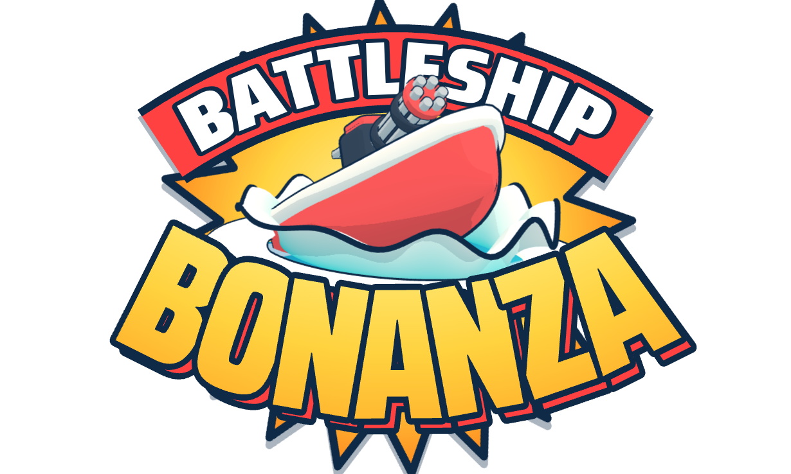

<h1 align="center">
  
</h1>

Cute boats. Big guns. Pick two attachments and race to the finish!

Play it [here](https://joshuaswanson.github.io/battleship-bonanza/).

## Technical details

- **3D engine:** [three.js](https://threejs.org), rendering with WebGL
- **Build tool:** [Vite](https://vite.dev)
- **Language:** plain JavaScript (ES modules), HTML and CSS
- **Shaders:** custom GLSL shaders for the water, fire, charring, tree cutting, laser burns and terrain textures
- **3D models:** built in code from three.js geometry. The two downloaded models load as glTF files through three.js's `GLTFLoader`
- **Rendering speed:** merged geometry (`BufferGeometryUtils`) and instanced meshes (`InstancedMesh`)
- **Audio:** Web Audio API for sound effects, HTML audio for the music
- **Fonts:** Fredoka and Saira Condensed from [Fontsource](https://fontsource.org)
- **Testing:** [Puppeteer](https://pptr.dev) driving headless Chrome, run by GitHub Actions before each deploy
- **Hosting:** GitHub Pages
